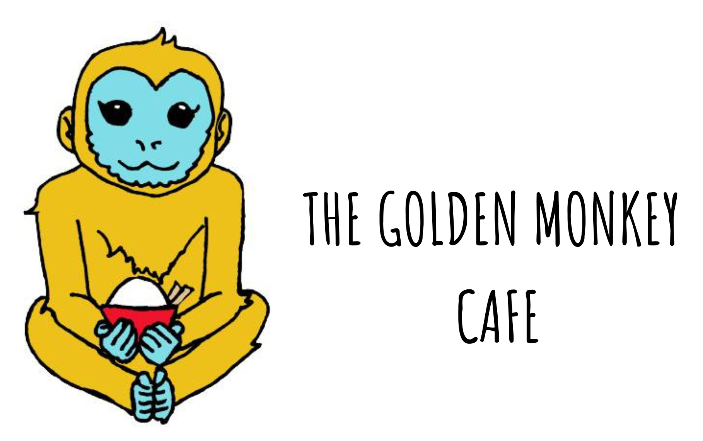

# Golden Monkey Restaurant Website - ASU Capstone Project

<h3>Authentic Cambodian Cuisine</h3>

<h3>⭐️ About the Project</h3>

A responsive restaurant website built to introduce the community to the Golden Monkey cafe in a new way. The main focus was on creating a digital experience that reflects the restaurant's identity, celebrates Cambodian cuisine, and introduces visitors to its story. 

<h3> 🇰🇭 Inspiration</h3>

This project was inspired growing up in my hometown. Living in Lynn MA, I've had the pleasure of being apart of a large Cambodian population. From the food, culture and people, I've been exposed to what makes their culture worth contributing to in the form of web development. This restaurant website encapsulates the flavors of their delicious cuisine, essence and cultural pride

***

<h3>🚀 Project Features</h3>

  - Interactive Homepage: jQuery-powered image carousel showcasing the restaurant.
  - Menu: Organized menu presentation highlighting Cambodian cuisine.
  - Our Story: Content centered around the restaurant's roots, cuisine and community.
  - Interactive Tabs: Sections highlighting Tradition, Flavor and Family.
  - Photo Gallery: Visual showcase of the restaurant and its food.
  - Google Maps Integration: Embedded map displaying the restaurant's location.
  - Responsive Design: Optimized layouts for desktop and mobile screens.
  - Order Online: Direct link to the restaurant's Uber Eats ordering page.

***

<h3>🔧 Tools & Technologies</h3>

| Tool | Purpose | 
| -------- | -------- | 
| HTML5  | Website structure and content | 
| CSS3  | Styling, layouts and responsive design | 
| JavaScript  | Interactive functionality  | 
| jQuery  | Homepage carousel and interactive tabs  | 
| Google Maps API  | Restaurant location integration  | 

***

<h3>🖌️Design & Branding</h3>

***

<h3>💻 Website Preview</h3>

